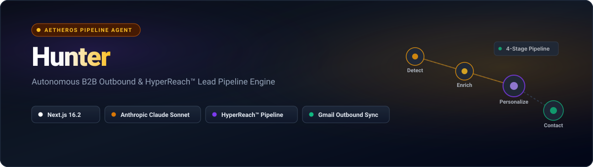
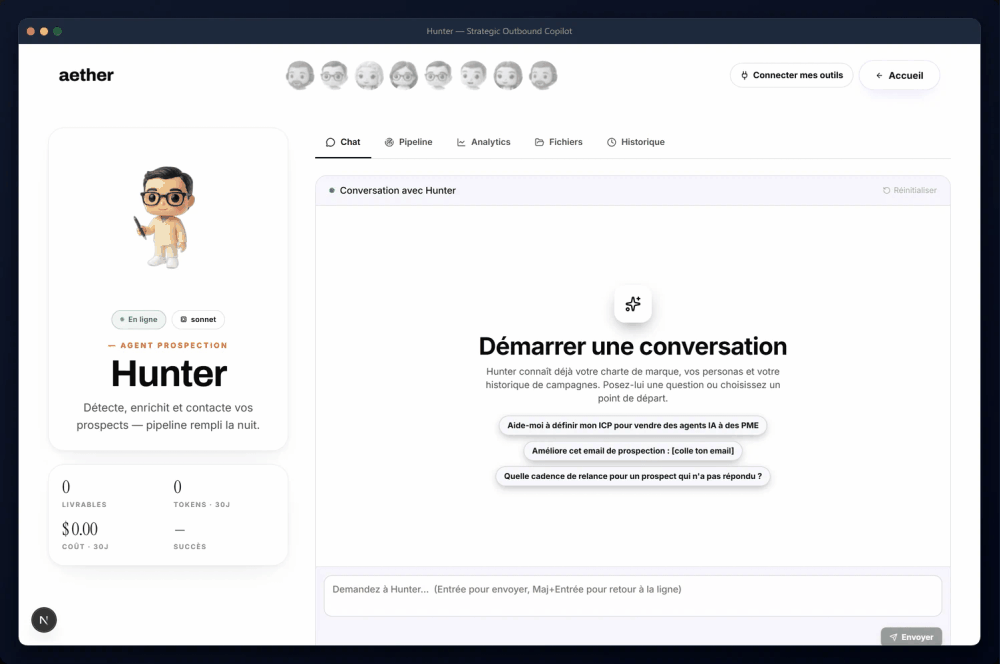
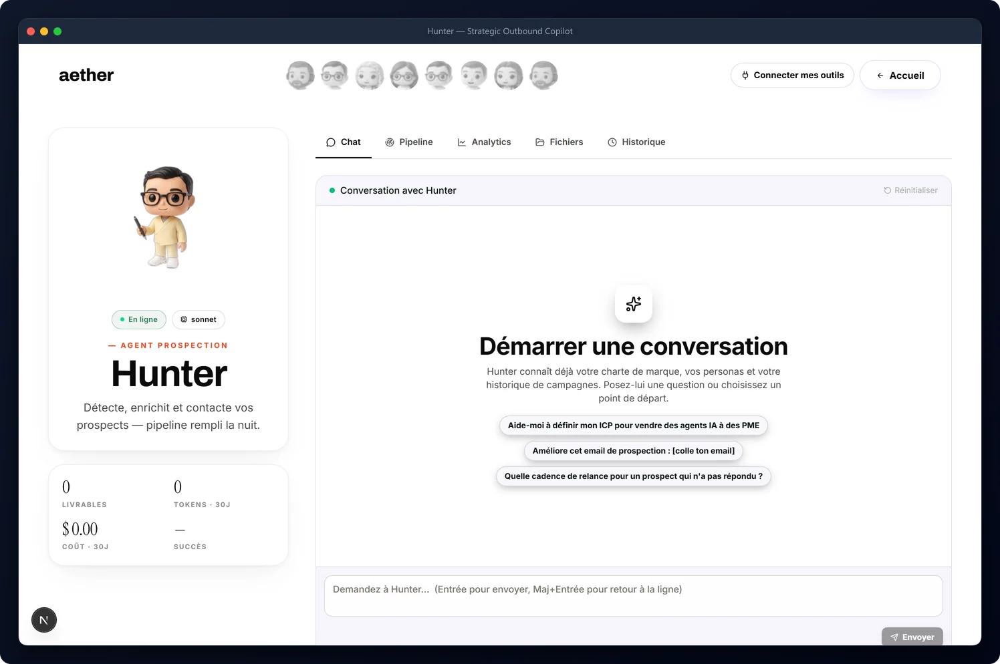
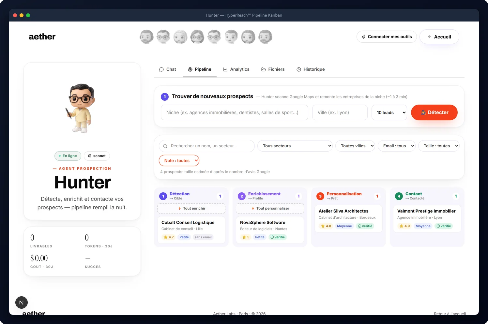
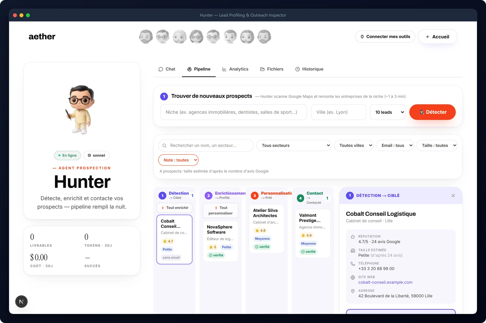
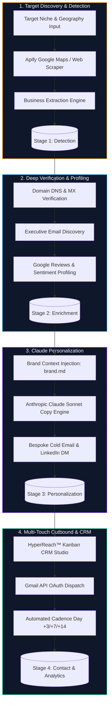

<div align="center">



# Hunter — Autonomous B2B Outbound & HyperReach™ Lead Pipeline Engine

[](https://nextjs.org/)
[](https://react.dev/)
[](https://www.typescriptlang.org/)
[](https://www.anthropic.com/)
[](https://github.com/)
[](LICENSE)

<p align="center">
  <a href="#live-demo"><b>Live Demo</b></a> •
  <a href="#screenshots"><b>Screenshots</b></a> •
  <a href="#key-capabilities--studio-ui"><b>Capabilities</b></a> •
  <a href="#architecture"><b>Architecture</b></a> •
  <a href="#how-to-install--configure"><b>Installation</b></a> •
  <a href="#how-to-use"><b>How to Use</b></a>
</p>

</div>

---

**Hunter** is an autonomous B2B outbound engine and lead pipeline studio powered by the proprietary **HyperReach™** methodology. Built on the **AetherOS** multi-agent architecture and powered by Apify scraping, Anthropic Claude intelligence, and direct Gmail synchronization, Hunter converts cold business targets into booked meetings through a structured 4-stage pipeline: Detection, Enrichment, Personalization, and Contact.

---

## Live Demo



---

## Screenshots

<table>
  <tr>
    <td width="50%" align="center">
      <br />
      <b>Hunter Command View &amp; Strategic Copilot</b><br />
      <sub>Real-time conversational advisory on ICP definition, value propositions, and objection handling</sub>
    </td>
    <td width="50%" align="center">
      <br />
      <b>HyperReach™ Pipeline Kanban CRM</b><br />
      <sub>Interactive 4-stage Kanban tracking prospects from detection through email dispatch</sub>
    </td>
  </tr>
  <tr>
    <td colspan="2" align="center">
      <br />
      <b>Lead Detail &amp; Outreach Inspector</b><br />
      <sub>Deep prospect profile with verified business metrics, Google reviews, and Claude outreach copies</sub>
    </td>
  </tr>
</table>

---

## Key Capabilities & Studio UI

### The 4-Stage HyperReach™ Pipeline
1. **Detection (Target Discovery)**: Scrapes high-intent B2B leads from Google Maps, LinkedIn, and web directories across targeted industries, niches, and geographic markets.
2. **Enrichment (Lead Profiling)**: Extracts rich prospect data including executive emails, verified domains, active social channels, headcount, and verified customer reviews.
3. **Personalization (Tailored Outreach)**: Crafts bespoke cold emails (&lt; 120 words) and high-impact LinkedIn direct messages (&lt; 300 characters) rooted in real prospect facts, verified achievements, and specific pain points.
4. **Contact (Multi-Touch Outreach)**: Synchronizes with Gmail to deliver personalized cold emails offering free audits or targeted consultations, paired with strategic follow-up cadences (Day+3, Day+7, Day+14).

### Specialized Studio UI
- **Pipeline Dashboard**: An interactive visual kanban and lead table directly beside the AI copilot chat, enabling one-click lead scraping, bulk enrichment, copy approval, and outbound dispatch.
- **AI Strategy Copilot**: Real-time conversational advisory on Ideal Customer Profile (ICP) definition, value proposition tuning, objection handling, and GDPR compliance validation.
- **Single-Agent Focus**: Pre-configured in standalone single-agent mode via template lock (`OWNED_AGENT=prospection`), providing an uncluttered, tailored workspace.

---

## Architecture

### System Flowchart



### Directory Structure

```
hunter-outbound-engine/
├── .claude/
│   └── agents/
│       └── prospection.md       # Hunter agent blueprint & system prompt
├── aether-studio/               # Next.js 16 full-stack Studio application
│   ├── src/
│   │   ├── app/                 # Next.js App Router (Studio views & API endpoints)
│   │   ├── components/          # React 19 UI components & Pipeline dashboard
│   │   └── lib/
│   │       ├── prospection/     # Lead store, verification & outbound utilities
│   │       └── integrations/    # Apify scraper, Gmail & Anthropic SDK clients
│   ├── .env.example             # Documented environment variables template
│   └── package.json             # Studio dependencies & scripts
├── clients/
│   └── votre-marque/
│       └── brand.md             # Brand positioning, ICP rules & tone of voice
├── docs/
│   └── screenshots/             # Framed WebP captures and demo assets
│       ├── demo.gif             # Real interactive pipeline recording
│       ├── hero-banner.svg      # Clean dark-slate presentation vector banner
│       ├── hunter-agent-view.webp # Unified strategic copilot view
│       ├── hunter-lead-detail.webp # Deep lead profiling & outreach inspector
│       └── hunter-pipeline-kanban.webp # HyperReach™ pipeline kanban CRM
├── prospection/
│   └── store.json               # Persisted B2B leads and HyperReach™ pipeline state
├── CLAUDE.md                    # Zero-friction agent launch instructions
└── README.md                    # Repository documentation
```

---

## How to Install & Configure

Follow these steps to set up and run Hunter locally:

### 1. Prerequisites
- **Node.js**: v20.x or higher (`node -v`)
- **npm**: v10.x or higher (`npm -v`)
- **Anthropic API Key**: Obtain from [Anthropic Console](https://console.anthropic.com/settings/keys)
- **Apify API Token**: (Optional for live scraping) Obtain from [Apify Console](https://console.apify.com/account/integrations)
- **Google Cloud OAuth Credentials**: (Optional for Gmail synchronization) Set up via [Google Cloud Console](https://console.cloud.google.com/)

### 2. Clone Repository & Install Dependencies
```bash
git clone https://github.com/Emincanozen/hunter-outbound-engine.git
cd hunter-outbound-engine/aether-studio
npm install --no-audit --no-fund
```

### 3. Environment Configuration
Copy `.env.example` into `.env.local`:
```bash
cp .env.example .env.local
```

Configure your secrets in `.env.local`:
```env
# Anthropic Claude API Key (Required for lead analysis and copy generation)
ANTHROPIC_API_KEY="sk-ant-api..."

# Standalone Template Lock (Preset to prospection)
OWNED_AGENT=prospection
NEXT_PUBLIC_OWNED_AGENT=prospection

# Apify Token (Required for automated Google Maps / B2B lead scraping)
APIFY_TOKEN="apify_api_..."

# Google OAuth Credentials (Optional: enables direct Gmail dispatch)
# GOOGLE_CLIENT_ID="...apps.googleusercontent.com"
# GOOGLE_CLIENT_SECRET="..."
# GOOGLE_REDIRECT_URI="http://localhost:3000/api/integrations/google/callback"
```

### 4. Launch the Development Server
```bash
npm run dev
```

Navigate to `http://localhost:3000` (or `http://localhost:3205` if running with custom port `-p 3205`). The application will redirect straight to `/agents/prospection`.

---

## How to Use

### 1. Discover Leads in Your Target Market
1. Open the **Pipeline** tab in the studio navigation bar.
2. In the **Trouver de nouveaux prospects** bar:
   - Enter your target niche (e.g. `Agences immobilières`, `Cabinets d'architecture`, `SaaS B2B`).
   - Enter your target city or region (e.g. `Lyon`, `Bordeaux`, `Paris`).
   - Select batch size (e.g. `10 leads`).
3. Click **Détecter**. Hunter launches the Apify scraper to pull Google Maps business profiles, websites, addresses, and customer reviews into the **Détection (Ciblé)** column.

### 2. Enrich & Validate Lead Contact Info
1. Click **Tout enrichir** or click on any individual card in the **Détection** column.
2. Hunter visits the company website, detects executive email addresses, validates MX domain records, and indexes social channels.
3. Enriched leads move automatically to the **Enrichissement (Profilé)** column.

### 3. Generate Hyper-Personalized Outreach Copy
1. Click **Tout personnaliser** or click on any enriched prospect.
2. Claude reviews the prospect's verified achievements, Google review feedback, and positioning against your `brand.md` guide.
3. Hunter produces:
   - A short, punchy cold email (&lt; 120 words) with a clear, non-pushy call to action.
   - A tailored LinkedIn connection request (&lt; 300 characters).
4. Leads advance to the **Personnalisation (Prêt)** stage.

### 4. Send & Track Outbound Outreach
1. Open any lead in the **Personnalisation** stage to review and approve the draft.
2. Click **Envoyer le message** to dispatch via your connected Gmail inbox.
3. The prospect moves to **Contact (Contacté)** with timestamps and follow-up reminders.

---

## How to Create & Customize Agents

The AetherOS architecture allows you to tailor Hunter's behavior or scaffold complementary B2B agents:

### 1. Tailoring Brand Context & ICP
Edit `clients/votre-marque/brand.md`:
```markdown
# Brand Context — Votre Marque
- **Company Name**: Your Business Name
- **Value Proposition**: We help mid-market firms automate repetitive client reporting and lead qualification.
- **ICP Criteria**: Service businesses with 10–50 employees, > 20 Google reviews, currently handling inbound requests manually.
- **Tone & Posture**: Professional, direct, consultative, zero aggressive sales hype.
```

### 2. Modifying Outbound Playbooks
Hunter's system rules reside in `.claude/agents/prospection.md`. You can fine-tune:
- Cold email frameworks (e.g. Problem-Agitate-Solve vs. Value Observation).
- Strict constraints against generic flattery or template jargon.
- GDPR and cold outreach compliance rules.

### 3. Adding New Agents to the Suite
To create a specialized agent (e.g., an Account-Based Marketing researcher):
1. Add `.claude/agents/<slug>.md` with the role and system prompt.
2. Add the agent slug to `aether-studio/src/lib/agents.ts`.
3. Build or customize dedicated studio panels in `aether-studio/src/components/`.
4. Store persistent stage data in `{repo}/<slug>/store.json`.

---

## Environment Variables Reference

| Variable | Required | Default | Description |
| :--- | :---: | :---: | :--- |
| `ANTHROPIC_API_KEY` | **Yes** | — | Anthropic Claude API key for intelligence and copy generation. |
| `OWNED_AGENT` | **Yes** | `prospection` | Locked to `prospection` for Hunter standalone mode. |
| `NEXT_PUBLIC_OWNED_AGENT` | **Yes** | `prospection` | Client-side identifier locked to `prospection`. |
| `APIFY_TOKEN` | Recommended | — | Token for B2B Google Maps, LinkedIn, and web scraping actors. |
| `GOOGLE_CLIENT_ID` | Optional | — | Google OAuth Client ID for Gmail API outreach. |
| `GOOGLE_CLIENT_SECRET` | Optional | — | Google OAuth Client Secret for Gmail API outreach. |
| `GOOGLE_REDIRECT_URI` | Optional | — | Google OAuth Callback URL. |
| `ANTHROPIC_MODEL_SONNET` | Optional | `claude-sonnet-4-20250514` | Model override for Claude Sonnet calls. |
| `ANTHROPIC_MODEL_OPUS` | Optional | `claude-opus-4-20250514` | Model override for Claude Opus calls. |
| `NEXT_PUBLIC_UNLOCK_URL` | Optional | — | Target URL or contact page to unlock additional AetherOS agents. |

---

## License & Credits

Built with [AetherOS Architecture](https://github.com/) & [Next.js 16](https://nextjs.org/). Powered by Anthropic Claude and Apify.
Released under the MIT License.
